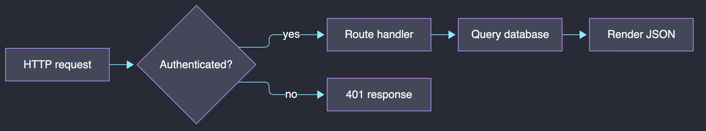
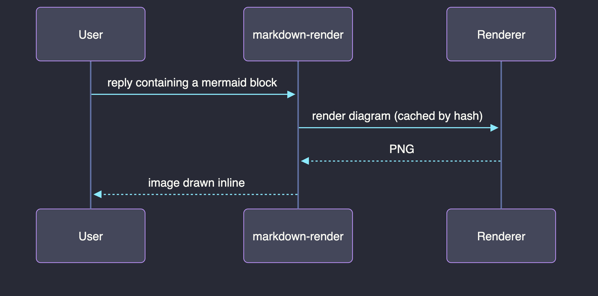

# markdown-render

A Claude Code mod that renders GitHub-flavored markdown extras in assistant replies, in the terminal:

- **Mermaid code blocks as images**, rendered inline, Dracula theme by default, cached by content hash
- **GitHub alerts** (`> [!NOTE]`, `[!TIP]`, `[!IMPORTANT]`, `[!WARNING]`, `[!CAUTION]`) as coloured callouts with a tinted gutter
- **Collapsible `<details>` blocks**, drawn as a pressable summary row that expands and collapses on click, collapsed by default as the HTML element is
- **Task lists** as `☐`/`☑`, footnotes as superscripts, `<kbd>`, `<br>`
- **An `⤢ open` control under each rendered diagram** that opens the full-resolution PNG in your image viewer, for when a diagram is too dense to read at terminal size
- **An optional system-prompt section** that encourages Claude to reach for diagrams and keep markdown lean

Plain replies are handed straight to Claude Code's own renderer, so there is no cost when there is nothing extra to draw. Any failure falls back to the engine's drawing, or to the diagram source with an error line: a broken renderer never costs you the reply.

## What it looks like

When Claude writes a ```` ```mermaid ```` block, you get the picture instead of the source. These are real output from the renderer, in the default Dracula theme:





Diagrams are drawn at terminal-cell resolution over the reply text, scaled to your window width and capped at `maxRows` tall. Alerts, task lists and footnotes are drawn as terminal text alongside them: `> [!WARNING]` becomes a titled callout with a coloured gutter bar, `- [ ]` becomes `☐`, and `[^1]` becomes `¹`.

## Install

### 1. Install a diagram renderer first

Mermaid blocks need one of these on your machine. Without it everything else still works, but diagrams show their source instead of an image.

Preferred, native and browserless, about 15 MB per render:

```sh
brew tap 1jehuang/mmdr && brew install mmdr
```

Fallback, mermaid-cli driving your installed Chrome, about 300 MB per render:

```sh
mkdir -p ~/.cache/claude-md-render && cd ~/.cache/claude-md-render \
  && PUPPETEER_SKIP_DOWNLOAD=1 npm i @mermaid-js/mermaid-cli
```

With `renderer: auto` (the default) the mod uses `mmdr` when it finds it and falls back to mermaid-cli.

### 2. Install the mod

At the prompt of a terminal Claude Code session:

```
/plugin install markdown-render --marketplace jrcasso/markdown-render
```

You will be asked `Add marketplace?`, which you answer with `y`, then shown the plugin's details and a scope (press Enter for the default **user** scope, which loads it in every session). Because this is a hooks-only mod, it goes active in that same session with no reload.

From a shell instead:

```sh
claude plugin install markdown-render --marketplace jrcasso/markdown-render
```

In the desktop app, where `/plugin` does not run: click **+** next to the prompt box, then **Plugins**, **Add marketplace** with `jrcasso/markdown-render`, then **Add plugin**.

## Settings

Configure via `/config`, or `pluginConfigs.markdown-render` in `settings.json`:

| Setting | Default | Meaning |
| --- | --- | --- |
| `theme` | `dracula` | `dracula`, `dark`, `default`, `neutral`, `forest` |
| `renderer` | `auto` | `auto`, `mmdr`, `mermaid-cli` |
| `cellAspect` | `2` | Terminal cell height divided by width, for image sizing. Raise it if diagrams look stretched tall, lower it if squashed |
| `maxRows` | `45` | Taller diagrams are scaled down to fit |
| `retentionDays` | `14` | Rendered diagrams older than this are deleted at session start |
| `diagramLevel` | `balanced` | How strongly Claude is pushed toward diagrams: `off`, `minimal`, `balanced`, `eager` (see below) |

### Diagram eagerness

`diagramLevel` sets only how hard the injected system-prompt section pushes for diagrams. The rules that keep a diagram renderable (left-to-right layout, node budget, label quoting, no custom colors) and the guidance on GitHub alerts are included at every level except `off`.

| Level | What Claude is told |
| --- | --- |
| `off` | Nothing is injected. Claude writes whatever markdown it would anyway. |
| `minimal` | Diagrams are available but not the default. Draw one only where it clearly beats prose, or when asked. |
| `balanced` | Draw one when a reply describes three or more things that connect, or steps that branch or loop. One diagram suits most replies. |
| `eager` | Default to a diagram. Replace numbered step lists and `A -> B -> C` chains with one, and lead with it. |

Higher levels mean more renderer calls, so on the mermaid-cli fallback (about 300 MB of Chrome per uncached render) `eager` costs noticeably more than `balanced`.

## Requirements

- **A terminal session.** The rendering hooks only draw for the `terminal` surface; other surfaces are passed through untouched.
- **Fullscreen rendering** (`"tui": "fullscreen"`) for the clickable controls. The terminal only reports clicks to a plugin under the fullscreen renderer; elsewhere the summary row and `⤢ open` still draw but cannot be pressed.
- **An image-capable terminal** for diagrams: kitty or Ghostty (kitty graphics protocol), or iTerm2 3.5+ under fullscreen rendering. Inside tmux you also need `allow-passthrough` and `focus-events` on. Elsewhere a diagram draws its alt text.
- **macOS**, currently. Diagram downscaling shells out to `sips`, the `⤢ open` control shells out to `/usr/bin/open`, and the mermaid-cli path looks for Chrome at its standard macOS location. Everything except diagram rendering is platform-independent, so Linux support needs only those two spots generalised. Patches welcome.

## Development

```sh
claude --plugin-dir .          # run a session with the mod loaded from this folder
claude plugin validate .       # check the manifest, marketplace file and hooks module
claude plugin test .           # run render.test.tsx
```

The engine writes TypeScript definitions into `.claude-plugin/types/` once it has loaded the mod, and the top-level `tsconfig.json` extends the one it puts there, so `tsc -p .` type-checks only after a first load. Those generated types are gitignored.

## License

MIT, see [LICENSE](LICENSE).
